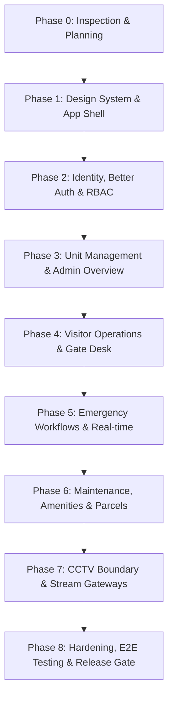

# SocietyOS — Master Implementation Plan

**Version:** 1.0  
**Date:** 20 October 2026  
**Status:** Planning & Architectural Specification (Phase 0 Complete — No Application Code Written Yet)  

---

## 1. Executive Summary & Audit Findings

### 1.1 Repository & Environment Inspection
- **Working Directory:** `c:\Praveen\Projects\SocietyOS`
- **Current State:** Clean directory initialization. No legacy code, broken packages, or conflicting configs existed prior to audit.
- **Runtime Environment:**
  - Node.js: `v22.22.3`
  - npm: `10.9.8`
  - Python: `3.13.0` (utilized for UI/UX Pro Max design intelligence search)
  - OS: Windows 11 Enterprise
- **Package Manager Selection:** Single package manager rule enforced — **npm** with strict lockfile (`package-lock.json`).

### 1.2 Non-Negotiable Operational Principles
1. **Plan First, Code Second, Test Third:** Architecture, schemas, threat models, permissions, and test strategies must be formally documented prior to writing application code.
2. **MongoDB Persistence as Sole Source of Truth:** No in-memory arrays, local file storage, or browser `localStorage` substitutes for application state. Local storage is strictly restricted to non-sensitive UI preferences (e.g. sidebar collapsed state); never tokens or credentials.
3. **Server-Side Enforcement Everywhere:** Every state mutation, query, export, image fetch, and subscription must re-verify role and resource ownership on the server. Client UI visibility is purely a UX affordance, never a security boundary.
4. **Honest Integration Disclosure:** No fake live CCTV streams, simulated emergency dispatch, or fabricated metrics. If an integration (CCTV, transactional email, Ably realtime, S3 storage) is not configured with live credentials, the UI must explicitly declare `Not Configured` or `Unavailable`.
5. **Multi-Tenant Society Boundary:** Every collection, query, and mutation enforces `societyId` scoping to prevent cross-society data leakage from day one.
6. **Limitation of Scope Notice:** SocietyOS is built as a demonstration residential operations platform. It does not replace official emergency numbers (911/112/999), certified fire/life-safety alarms, hardware access-control controllers, or certified CCTV/NVR monitoring.

---

## 2. Staged Milestone Roadmap (8 Phases)

### Phase 0: Audit, Threat Modeling & Architectural Specification *(Current)*
- Audit workspace and environment toolchains.
- Run UI/UX Pro Max design intelligence engine; generate and persist `design-system/societyos/MASTER.md`.
- Author foundational architectural documentation:
  - `docs/IMPLEMENTATION_PLAN.md`
  - `docs/ARCHITECTURE.md`
  - `docs/PERMISSION_MATRIX.md`
  - `docs/THREAT_MODEL.md`
  - `docs/TEST_PLAN.md`
- **Gate:** All documentation committed. No application code written.

### Phase 1: Foundation, Design Tokens, Landing Page & App Shell *(Next Step)*
- Initialize Next.js 15 (or latest stable App Router) with strict TypeScript, Tailwind CSS, shadcn/ui primitives, Radix UI, Lucide React, and `motion` (`motion/react`).
- Implement the design tokens in `src/styles/globals.css` adhering to `design-system/societyos/MASTER.md`:
  - Canvas: `#F6F6F1`, Ink: `#17231D`, Brand: `#276749`, Sage: `#E4ECE5`, Amber: `#B86A2B`, Red: `#B42318`.
- Build the public landing page (`/`), privacy policy (`/privacy`), security statement (`/security`), and unauthenticated invitation landing (`/invite/accept`).
- Construct static labeled preview: *"Product preview — sample data"*.
- Implement typed environment validation (`src/lib/env/index.ts`) using Zod.
- Configure MongoDB driver connection singleton (`src/lib/db/mongodb.ts`) ensuring development HMR reuse and connection pooling.
- Create base operational dashboard layouts (sidebar navigation, responsive header, connection status indicator, accessible skip links).
- Set up test runners: Vitest, React Testing Library, Playwright, ESLint, TypeScript compiler.
- **Gate:** `npm run lint`, `npm run typecheck`, initial smoke tests, and production build pass.

### Phase 2: Identity, Sessions, Better Auth, Invitations & RBAC
- Implement Better Auth with the official MongoDB adapter (`@better-auth/mongo-adapter`).
- Implement invite-only registration: Admin creates invite record with hashed single-use token, expiration, and pre-bound role. Invitee completes onboarding; client cannot tamper with role.
- One-time initial Administrator bootstrap script (`scripts/bootstrap-admin.ts`) using secure environment inputs. No default passwords in repo.
- Email verification and password reset flows with swappable transactional email adapter (Resend for production/staging; in-memory / local sink for development).
- Documented Multi-Factor Authentication (TOTP + recovery codes) strictly enforced for `ADMIN` and `SECURITY` roles.
- Server-side session verification via `HttpOnly`, `Secure`, `SameSite=Lax` cookies. Automatic session rotation on privilege change/revocation.
- Login rate-limiting and abuse detection with constant-time generic error responses.
- Central authorization guards: `requireSession()`, `requireRole()`, `requirePermission()`, and resource ownership helpers.
- **Gate:** Integration tests verifying unauthenticated blocks, role tampering failures, token replay prevention, and MFA gate validation.

### Phase 3: Units, Occupancy & Society Administrator Overview
- MongoDB Collections: `units`, `occupancyEvents`, `announcements`, `auditLogs`.
- Canonical unit management: Unit codes, floor/blocks, statuses (`VACANT`, `OCCUPIED`, `RESERVED`, `MAINTENANCE`), household memberships.
- Concurrency and consistency control: Atomic conditional updates ensuring status transitions (e.g. `VACANT` $\to$ `OCCUPIED`) generate append-only `occupancyEvents` without race conditions.
- Opt-in public/resident vacancy directory (strictly redacts previous occupants and personal records).
- Society Administrator dashboard with live KPI counters, audit event stream, announcements publisher with correction history.
- **Gate:** Unit transition tests, tenant isolation tests, concurrent occupancy race test, and audit log immutability verification.

### Phase 4: Visitor Pass Lifecycle & Security Gate Operations
- MongoDB Collections: `visitorPasses`, `entryLogs`, `patrolRecords`.
- Resident visitor pass issuance: Short code generation + signed/opaque QR payload (strictly zero PII encoded in the QR code). Expiry windows, visitor limits, purpose.
- Security console (`/security`): Optimized for quick keyboard and touch interactions at the gate desk.
- Verification & Check-in / Check-out: Server-side validation of pass status, expiry date/time, and permitted society.
- Idempotency & Concurrency: Atomic conditional check-in preventing double entries or duplicate exit timestamps.
- Manual visitor entry flow requiring mandatory reason code and audited security user reference.
- Shift handover logging and manual patrol checkpoint recording.
- **Gate:** QR pass security audit, duplicate scan rejection test, expired/revoked pass refusal test, and role separation tests.

### Phase 5: Emergency Incident Workflow & Resilient Real-Time System
- MongoDB Collections: `emergencyIncidents`, `incidentEvents`, `outboxEvents`, `notifications`.
- Safety-critical incident pipeline:
  1. Resident submits SOS (category, unit, location, notes).
  2. Durable persistence to MongoDB *before* any network dispatch or event emission.
  3. Automatic generation of public reference (`INC-YYYYMMDD-XXXX`), severity level, and initial audit event.
  4. Real-time broadcast attempt via swappable adapter (e.g. Ably / WebSocket).
  5. Durable outbox queue with exponential backoff retries if real-time provider is unreachable.
- Security/Admin incident response: Acknowledge incident, assign responder, add responder notes, mark resolved, mark closed.
- Resilient client: Auto-reconnect with cursor-based event catch-up; HTTP polling fallback every 5 seconds when real-time connection drops; clear connection status badge.
- Prominent disclaimers: Emergency hotline device triggers (`tel:112`); explicit warning that browser software does not replace local emergency services.
- **Gate:** Real-time disconnection test (kill realtime provider, verify incident still persists and recovers via polling), deduplication test, status machine validation.

### Phase 6: Maintenance Requests, Amenities, Parcels & In-App Notifications
- MongoDB Collections: `maintenanceTickets`, `maintenanceEvents`, `amenities`, `amenityBookings`, `parcels`.
- Maintenance ticket tracker: Resident reports issue with urgency; admin routes and assigns; status transitions with audited comments.
- Amenity booking engine: Capacity rules, operating hours, blackout windows, and atomic overlap conflict prevention at the database level.
- Parcel desk: Security logs incoming courier packages by unit; resident notified; secure handover confirmation recorded.
- In-app notification center: Unread counters, read receipts, authorized deep linking.
- **Gate:** Concurrency booking clash test, resident cross-unit ticket privacy test, parcel handover verification test.

### Phase 7: CCTV Management & Secure Streaming Boundary
- MongoDB Collection: `cameras`.
- Camera metadata inventory: Name, zone/gate, provider type, enabled status, health status, retention policy reference.
- Security Boundary & Privacy:
  - **Zero RTSP URLs, passwords, or NVR tokens sent to the browser.**
  - If a production WebRTC/HLS media gateway is not configured with verified credentials, the UI displays *"Camera integration not configured"*.
  - No fake simulated feeds or video loops disguised as live cameras.
  - Authorized security viewing generates an immutable `auditLogs` record with timestamp and camera ID.
  - Short-lived signed playback grants (valid for 60 seconds) issued only after server-side RBAC validation.
- **Gate:** Network packet inspection test (verifying zero credentials in browser bundle/responses), resident 403 forbidden test, SSRF host whitelist validation.

### Phase 8: Hardening, Comprehensive Testing, Packaging & Release Gate
- Full automated test suite execution:
  - Strict TypeScript compilation (`tsc --noEmit`).
  - ESLint verification with zero warnings.
  - Vitest unit and integration suite.
  - Playwright E2E suites covering Resident, Security, and Admin personas across desktop (1440px) and mobile (375px) viewports.
  - Automated accessibility scans using `@axe-core/playwright`.
  - Security review (OWASP Top 10, NoSQL injection resistance, CORS/CSP headers, cookie security).
- Production build validation (`npm run build`).
- Documentation: Environment setup (`.env.example`), database index creation script, admin bootstrap guide, backup/restore instructions, and deployment guide.
- Formal Release Handover Report.

---

## 3. Assumptions, Ambiguities & Conservative Resolutions

| Area | PRD Requirement / Ambiguity | Conservative Architectural Resolution |
|------|-----------------------------|---------------------------------------|
| **Multi-Tenancy** | Single society initial focus, but cross-society leakage must be prevented. | Enforce `societyId: string` on every collection schema, index, and query filter from Day 1. |
| **Real-time Engine** | Must support free-tier with resilient fallback. | Abstract behind `RealtimeService` interface. Durable MongoDB outbox is source of truth; Ably or WebSockets used for instant notification; client automatically falls back to 5s HTTP polling if disconnected. |
| **Email Delivery** | Verification and reset emails required, but live SMTP keys may not be present during local dev. | Swappable `EmailProvider` interface. If `RESEND_API_KEY` is absent, write email payload to an in-memory/logger dev sink and output test reset link to console. Production fails fast if key is missing. |
| **CCTV Streaming** | Real RTSP cameras cannot play directly in browser; zero fake feeds allowed. | Never proxy raw RTSP or embed credentials. Provide full camera inventory, zone access control, and viewing audit. Stream player expects signed HLS/WebRTC endpoint from a verified media gateway; displays honest "Not configured" state otherwise. |
| **Emergency Calling** | Resident UI includes emergency call buttons. | Use standard `tel:<number>` URI schemes. Clearly label that this triggers the user's native phone dialer and that SocietyOS does not place automated emergency calls or dispatch services directly. |
| **File Attachments** | Incident/maintenance photos allowed if uploads enabled. | Validate MIME type against strict allowlist (JPEG, PNG, WebP), enforce 5MB size limit, generate random server UUID filenames, and store metadata in MongoDB. In local dev, store in restricted static dir; support S3/R2 via adapter. |

---

## 4. Free-Tier Constraints & Quota Mitigation

1. **MongoDB Atlas M0 Free Cluster:**
   - *Limitation:* 512 MB storage cap, 100 max connections, 100 ops/sec throughput, auto-pause after 30 days inactivity.
   - *Mitigation:* Lean document schemas, normalized references, efficient compound indexes, connection pooling singleton, and no binary/video storage in database.
2. **Real-time Services (Ably Free Tier):**
   - *Limitation:* 6 million monthly messages, 200 peak concurrent connections.
   - *Mitigation:* Broadcast only compact event notifications with entity IDs (e.g. `{ event: 'INCIDENT_CREATED', id: '...' }`); client fetches full details via authorized REST API.
3. **Transactional Email (Resend Free Tier):**
   - *Limitation:* 100 emails/day, 3,000 emails/month, single verified domain.
   - *Mitigation:* Rate-limit password reset and invitation dispatches; use local dev sink during development and automated testing.
